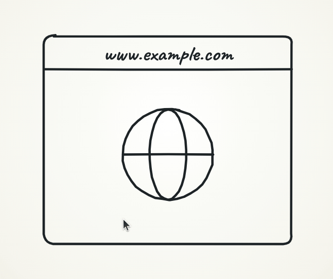
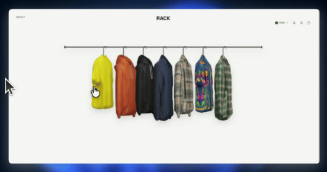
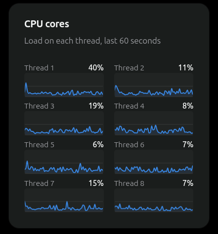
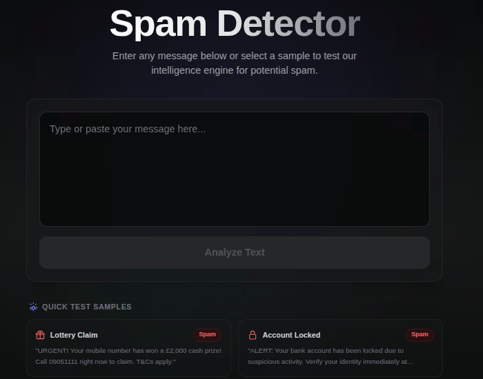
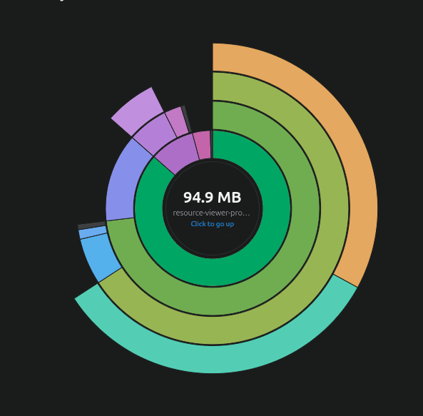
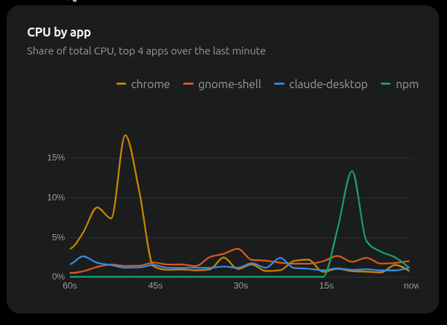
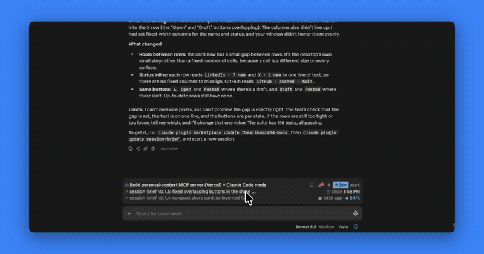

# I'm Hamza 

**Full-Stack Web & Mobile Developer | MERN & React Native** 

 

##  Philosophy
I believe technology should **simplify lives**, **empower businesses**, and create **seamless digital experiences**.

 

##  How I Work
I build **robust, scalable web and mobile applications** using **MERN** and **React Native**, turning **complex ideas into intuitive, high-performance solutions**.

 

##  What I Deliver
End-to-end products—from **responsive web platforms** to **cross-platform mobile apps**—designed to drive **engagement, growth, and efficiency**.

 

##  Tech Stack

  
   
  
   
  
   
  

 

##  Contact

  
  
  

 

##  Showcase
<table width="100%">
  <tr>
    <td align="center" width="50%"></td>
    <td align="center" width="50%"></td>
  </tr>
  <tr>
    <td align="center" width="50%"></td>
    <td align="center" width="50%"></td>
  </tr>
  <tr>
    <td align="center" width="50%"></td>
    <td align="center" width="50%"></td>
  </tr>
  <tr>
    <td align="center" colspan="2"></td>
  </tr>
</table>

 

<blockquote>💡 Code with purpose, design with clarity.</blockquote>
